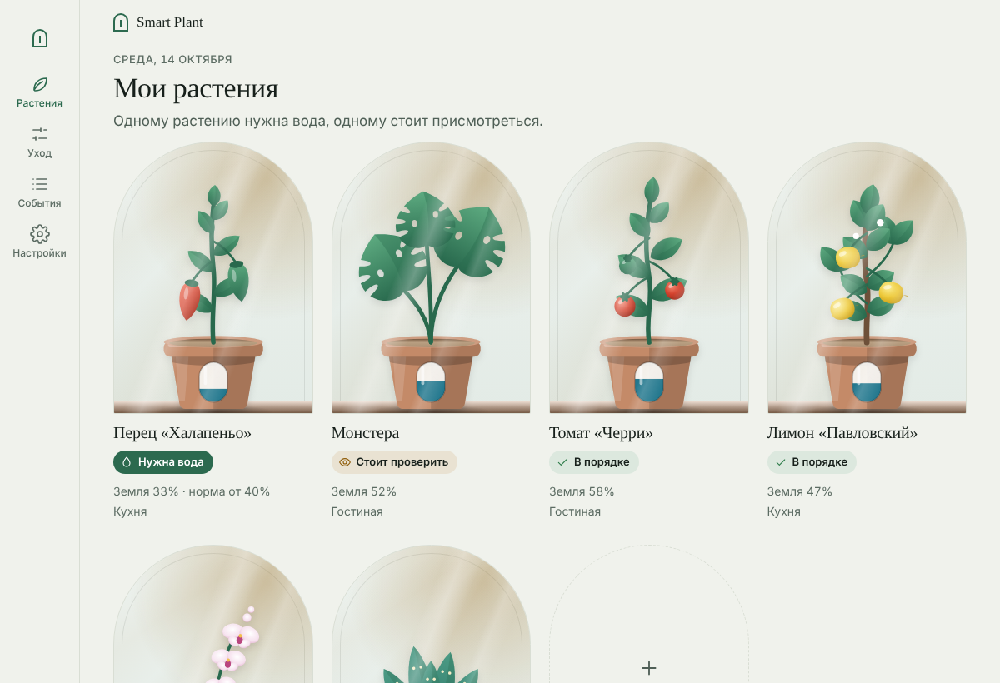

# Smart Plant OS

Локальная открытая система ухода за комнатными растениями. ESP32-S3 Hub показывает веб-панель и координирует до десяти ESP32-C3 Node. Каждый Node обслуживает одно растение и сохраняет локальные ограничения полива, поэтому растение не зависит от доступности Hub или домашнего Wi-Fi.

> **Состояние проекта:** инженерная версия для стенда. Есть настройка домашнего Wi-Fi, поиск C3, реальный сад и отдельный демонстрационный режим. Физические датчики и полив ещё требуют испытаний. Насосы и GPIO по умолчанию отключены.



## Быстрый запуск

Начните с ESP32-S3 Hub **N8R2** или **N16R8**. C3 можно добавить позже из приложения кнопкой «Добавить растение». Подключайте платы без насосов и других нагрузок.

```sh
python -m pip install -r tools/requirements-flash.txt
python tools/flash.py
```

На macOS/Linux используйте `python3`; на Windows — `python` или `py -3`. Есть запускатели `flash.cmd` и `./flash.sh`. Мастер предлагает первую установку, обновление с сохранением настроек и подготовку нового C3. Для готового USB-пакета нужен только Python; для сборки из исходников — ESP-IDF 5.3.4.

После первой установки подключитесь к **SmartPlantOS** и откройте **https://192.168.4.1/setup**. Пароль AP — `smartplantos`; индивидуальный файл доступа создаётся в приватном каталоге `secrets/`. Мастер проведёт через вход и подключение к домашнему Wi-Fi. Затем откройте домашний адрес Hub и добавьте C3 через автоматический поиск.

**[Пошаговая установка и обновление](docs/SETUP.md)** · [Инженерная инструкция](docs/FLASHING.md)

**[Обновление прошивок](docs/UPDATES.md):** для старых установок USB-мастер один раз добавляет два OTA-слота с сохранением NVS. Затем Hub и C3 обновляются из веб-приложения. Первичная установка, обновление и заводской сброс — отдельные операции. Не записывайте старые дампы NVS поверх действующих ключей.

## Как устроена система

- **Hub (ESP32-S3):** единая веб-панель, локальный REST API, список устройств и координация.
- **Node (ESP32-C3):** одно растение, датчики и автономные проверки полива.
- **Связь Hub–Node:** ESP-NOW с индивидуальными ключами. Домашняя сеть нужна Hub для присутствия в LAN и будущих локальных интеграций; облако проекту не требуется.
- **Установка:** ESP-IDF 5.3.4 и `tools/install.py`. Уникальные ключи генерируются локально при установке и сразу записываются в NVS каждой платы. Пользователю не нужно копировать радиоключи или редактировать CSV.
- **Безопасность полива:** команда интерфейса не управляет GPIO напрямую; Node выполняет локальные ограничения. В этом стендовом профиле GPIO насоса не назначены.

## Интерфейс

[web/index.html](web/index.html) — реальный сад: вход, контроллеры, комнаты, доступность и показания, настройка/калибровка объявленных датчиков, отвязка и обновления. Пустая установка не содержит вымышленных растений. Кнопка **«Посмотреть пример»** открывает [отдельное демо](web/demo.html), которое не обращается к API платы. Исходный концепт сохранён в [web/prototype.html](web/prototype.html).

Документы по реализации и ограничениям:

| Документ | Что в нём |
|---|---|
| [Обновления и откат](docs/UPDATES.md) | USB-миграция, обновление Hub/C3 из браузера и совместимость |
| [Прошивка по шагам](docs/FLASHING.md) | Первичная установка, обновление, USB и диагностика |
| [Сеть и каналы](docs/CONNECTIVITY.md) | Домашний Wi-Fi, точка доступа, ESP-NOW и ограничения каналов |
| [Архитектура](docs/ARCHITECTURE.md) | Роли Hub и Node, автономность, развитие |
| [Спецификация протокола](docs/PROTOCOL.md) | API, поля, ошибки и форматы данных |
| [SPP v1](spec/spp/v1/README.md) | Зашифрованный обмен Hub–Node |
| [Безопасность](docs/SECURITY.md) | Секреты, авторизация и границы защиты |
| [Участие](CONTRIBUTING.md) | Как вносить изменения в проект |

## Проверки проекта

```sh
npm ci
npm run check
```

Проверить макет-концепт локально можно командой `npm run serve`, затем открыть `http://localhost:8080/demo.html`. Для реальной панели нужен Hub и его HTTPS-адрес.

## Участие и лицензия

Перед изменениями прочитайте [CONTRIBUTING.md](CONTRIBUTING.md). Код распространяется по [Apache-2.0](LICENSE); аппаратные испытания, выбор распиновки и безопасное подключение нагрузки описаны отдельно и пока не завершены.

Новые C3 можно установить действием 3 USB-мастера и подключить из основного приложения кнопкой «Добавить растение»: автоматический поиск и согласование ключей, без ручного файла привязки. Первый обмен выполняйте в доверенном окружении; QR/проверка подлинности при первом подключении в текущем домашнем профиле отсутствуют. Подробности — [первый запуск](docs/SETUP.md).
