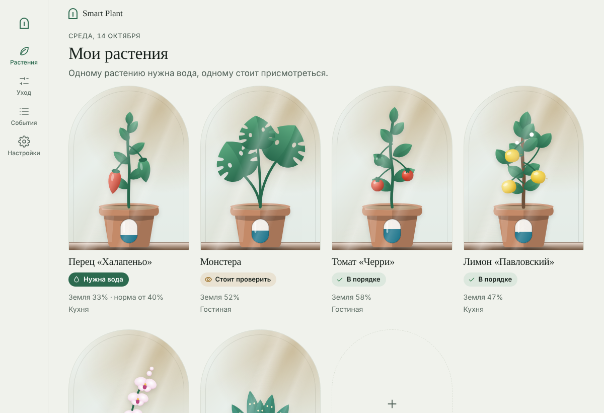

# Smart Plant OS

Локальная открытая система ухода за комнатными растениями. ESP32-S3 Hub показывает веб-панель и координирует до десяти ESP32-C3 Node. Каждый Node обслуживает одно растение и сохраняет локальные ограничения полива, поэтому растение не зависит от доступности Hub или домашнего Wi-Fi.

> **Состояние проекта:** инженерная версия для стенда. Подключение Hub к домашней сети и веб-панель подготовлены для первичной проверки; аппаратные сценарии ещё нужно проверить на реальных платах. Насосы и GPIO по умолчанию отключены.

## Быстрый запуск

Для первого запуска нужны ESP32-S3 Hub (N8R2 или N16R8), хотя бы один ESP32-C3 Super Mini, USB-кабели с передачей данных и компьютер с **ESP-IDF 5.3.4**. Сначала подключайте платы без насосов и других нагрузок.

1. Установите ESP-IDF 5.3.4 для C3 и S3 по [официальной инструкции Espressif](https://docs.espressif.com/projects/esp-idf/en/v5.3.4/esp32/get-started/index.html). Откройте ESP-IDF терминал.
2. Скачайте проект и перейдите в его папку:

   ```sh
   git clone https://github.com/Maxim-szh/smart-plant-os.git
   cd smart-plant-os
   ```

3. Подключите Hub и C3 по USB. Запустите мастер, заменив порт и профиль Hub на свои:

   ```sh
   python tools/install.py --hub-port COM5 --node-port COM6 --hub-profile n8r2
   ```

   На macOS/Linux используйте `python3`, например `--hub-port /dev/cu.usbmodem1101 --node-port /dev/cu.usbmodem101`. Для S3 N16R8 укажите `--hub-profile n16r8`. Дополнительные C3 подключаются повторением `--node-port`.

4. Мастер спросит имя и пароль домашнего Wi-Fi. Пароль вводится скрыто. Нажмите Enter вместо имени сети, если пока хотите проверить Hub только через его собственную точку доступа. Для домашней сети используйте Wi-Fi **2,4 ГГц**.
5. Подтвердите установку словом `INSTALL`. Мастер соберёт прошивки, сгенерирует уникальные ключи устройств, запишет их в Hub и C3 и сохранит данные для входа в `secrets/install-…/access.json`.
6. Подключите телефон или компьютер к Wi-Fi `SmartPlantOS`, откройте **https://192.168.4.1** и введите `admin_password` из `access.json`. При первом открытии браузер предупредит о локальном сертификате: проверьте отпечаток `certificate_sha256` из этого же файла.

Полная инструкция, включая обновление уже прошитых устройств и решение проблем: [docs/FLASHING.md](docs/FLASHING.md). **Не запускайте мастер первичной установки повторно для настроенных плат:** он создаёт новые ключи и исходное состояние. Не публикуйте папку `secrets/` и не отправляйте `access.json`.

Если указали домашнюю сеть, Hub сам определит канал после подключения и напечатает IP в serial monitor; адрес также можно найти в списке клиентов роутера. Заходить в настройки роутера и вручную выбирать канал не нужно. Hub, его точка доступа и ESP-NOW с C3 работают на одном канале; после потери связи C3 автоматически ищет Hub. В этом профиле поиск идёт по каналам 1–11. Если роутер выберет канал вне диапазона, Hub вернётся к собственной точке доступа на резервном канале. `--channel` задаёт резерв для автономной работы (по умолчанию 6). Панель первого запуска открывайте по `https://192.168.4.1`, подключившись к `SmartPlantOS`.



## Как устроена система

- **Hub (ESP32-S3):** единая веб-панель, локальный REST API, список устройств и координация.
- **Node (ESP32-C3):** одно растение, датчики и автономные проверки полива.
- **Связь Hub–Node:** ESP-NOW с индивидуальными ключами. Домашняя сеть нужна Hub для присутствия в LAN и будущих локальных интеграций; облако проекту не требуется.
- **Установка:** ESP-IDF 5.3.4 и `tools/install.py`. Уникальные ключи генерируются локально при установке и сразу записываются в NVS каждой платы. Пользователю не нужно копировать радиоключи или редактировать CSV.
- **Безопасность полива:** команда интерфейса не управляет GPIO напрямую; Node выполняет локальные ограничения. В этом стендовом профиле GPIO насоса не назначены.

## Интерфейс

Рабочая панель находится в [web/index.html](web/index.html) и отдаётся самой прошивкой Hub вместе с [web/live.js](web/live.js). Файл [web/prototype.html](web/prototype.html) — отдельный интерактивный дизайн-концепт; он не подключён к реальному API и не прошивается.

Документы по реализации и ограничениям:

| Документ | Что в нём |
|---|---|
| [Прошивка по шагам](docs/FLASHING.md) | Первичная установка, обновление, USB и диагностика |
| [Сеть и каналы](docs/CONNECTIVITY.md) | Домашний Wi-Fi, точка доступа, ESP-NOW и ограничения каналов |
| [Архитектура](docs/ARCHITECTURE.md) | Роли Hub и Node, автономность, развитие |
| [Спецификация протокола](docs/PROTOCOL.md) | API, поля, ошибки и форматы данных |
| [SPP v1](spec/spp/v1/README.md) | Зашифрованный обмен Hub–Node |
| [Безопасность](docs/SECURITY.md) | Секреты, авторизация и границы защиты |
| [Участие](CONTRIBUTING.md) | Как вносить изменения в проект |

## Участие и лицензия

Перед изменениями прочитайте [CONTRIBUTING.md](CONTRIBUTING.md). Код распространяется по [Apache-2.0](LICENSE); аппаратные испытания, выбор распиновки и безопасное подключение нагрузки описаны отдельно и пока не завершены.
